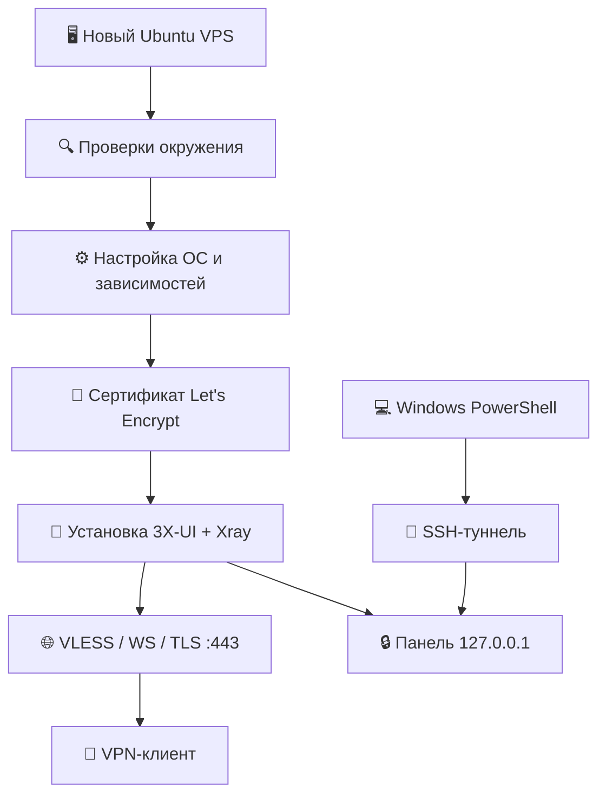
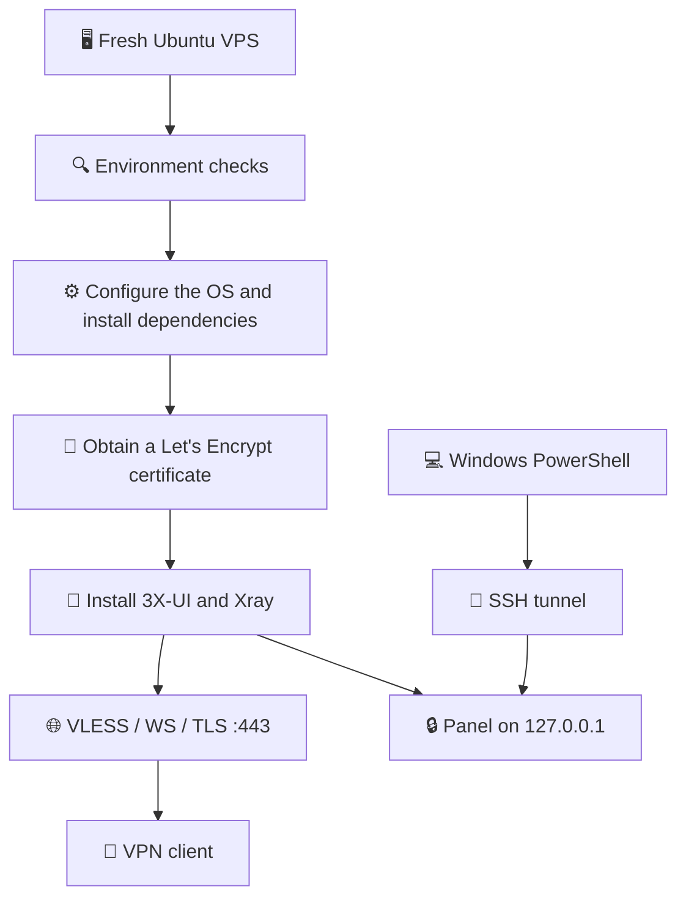

# Xray VPS Autodeploy

[Русский](#русский) · [English](#english)

## Русский

Развёртывание **нового VPS** на **Ubuntu 24.04 LTS (x86_64)** с **3X-UI v3.11.0**, Xray-core, **VLESS + WebSocket + TLS** и сертификатом Let's Encrypt. Репозиторий содержит только общие установочные скрипты и примеры; **никаких реальных паролей, ключей, IP, доменов и клиентских UUID**.

> **Осторожно:** сценарий предназначен только для **чистой установки**. Не запускайте `install.sh` на VPS с действующей 3X-UI/VPN: установщик не рассчитан на миграцию и откажется при существующей базе. Полный end-to-end запуск одной командой на новом VPS не подтверждён; сначала протестируйте на временном сервере.

[](https://ubuntu.com/)
[](https://github.com/MHSanaei/3x-ui)
[](https://github.com/XTLS/Xray-core)


### 📖 Быстрая навигация

| Раздел | Назначение |
| --- | --- |
| [🚀 Установка](#установка-одной-командой-интерактивный-мастер) | Запустить мастер на чистом VPS |
| [✨ Возможности](#-возможности) | Что делает установщик и чего не делает |
| [🏗️ Архитектура](#-как-это-работает) | Путь от установки до безопасной панели |
| [🔐 Панель 3X-UI](#доступ-к-3x-ui-из-windows) | SSH-туннель и просмотр реквизитов |
| [🧪 Проверки](#проверка-после-установки) | Контроль работоспособности |
| [🛡️ Безопасность](#безопасность-и-ограничения) | Границы автоматизации и риски |
| [🗂️ Файлы](#файлы-проекта) | Где находятся скрипты |

### ✨ Возможности

| Компонент | Реализация |
| --- | --- |
| 🖥️ Сервер | Чистый Ubuntu 24.04 LTS x86_64 |
| 🔧 Панель | 3X-UI v3.11.0 с SQLite по умолчанию |
| 🌐 VPN | VLESS + WebSocket + TLS, TCP 443 |
| 🔏 TLS | Let's Encrypt / Certbot для домена VPS |
| 🕳️ Администрирование | Панель на `127.0.0.1`, доступ через SSH-туннель |
| 📦 Бэкапы | Локальные снимки настроек и сертификатов |
| 🛡️ Контроль | Проверки состояния, базовые ограничения доступа |

### 🏗️ Как это работает



> **Граница применения:** установщик предназначен для **нового** VPS. Он не превращает несколько VPS в автоматический кластер, не переносит существующих пользователей и не переключает DNS автоматически.

---

### Что устанавливается

- 3X-UI версии `v3.11.0` из официального релиза.
- Xray-core: по умолчанию версия **из официальной сборки 3X-UI** (`XRAY_VERSION=bundled`); `latest` либо фиксированная версия доступны по явному выбору.
- VLESS inbound на TCP 443, WebSocket path из конфигурации, TLS (`http/1.1`).
- Let's Encrypt (Certbot standalone HTTP-01) и штатное продление Certbot.
- Панель управления **только на 127.0.0.1** с доступом через SSH-туннель.
- Локальные резервные копии SQLite и сертификатов; таймер локальных бэкапов.
- Ограничение доступа извне к порту подписок 2096 (IPv4 и IPv6) через отдельную systemd-службу, без удаления UFW.
- По умолчанию **не** меняет SSH-аутентификацию и **не** включает общий DROP firewall, чтобы не заблокировать SSH.

Проект **не** реализует автоматическое переключение VPS, балансировку, перенос пользователей между узлами или резервное копирование в облако.

### Требования

- Чистая Ubuntu 24.04 LTS x86_64, root/sudo, желательно не менее 2 ГБ RAM и 20 ГБ диска.
- Публичный IPv4, DNS-имя вида `vpn-example.duckdns.org`, указывающее на сервер.
- Открытые входящие TCP **80** (для выпуска/продления LE) и TCP **443** (VPN), включая настройки firewall провайдера.
- Рабочий SSH-доступ. Держите **вторую SSH-сессию** открытой при обновлении ОС и настройке.
- Email для Let's Encrypt; настроенный DuckDNS-домен. Токен DuckDNS необязателен, если DNS уже выставлен вручную.

### Порядок запуска и выбор версии Xray

Теперь интерактивный мастер **сразу после проверки чистого VPS** выполняет `apt-get update` и `apt-get upgrade -y` **до запроса VPN-параметров**. Это происходит один раз за текущую загрузку: `install.sh` обнаруживает локальный маркер обновления и не повторяет apt upgrade. Если после обновления требуется reboot, мастер сначала сохраняет введённые параметры; `install.sh` регистрирует одноразовую задачу systemd, перезагружает сервер и продолжает установку без новых вопросов. В случае ошибки после установки панели автоматический повтор по-прежнему запрещён.

Выбор версии Xray отображается **один раз** в виде меню:

- `1 — bundled`: комплектная версия Xray из 3X-UI, вариант по умолчанию;
- `2 — latest`: последняя стабильная версия;
- `3 — fixed`: запрос конкретной версии, например `v26.10.31`.

**Enter без значения выбирает bundled.** Число `latest`, случайные управляющие символы вставки или неправильные значения не запускают установку случайной версии: мастер попросит выбрать корректный пункт. При ручном выборе latest или fixed ответственность за совместимость с панелью требует отдельного тестирования.

### Информация при SSH-подключении

После **успешной** установки создаётся root-only информация о VPS. При интерактивном SSH-входе под `root` выводятся Ubuntu, ядро, версии 3X-UI/Xray/пакетов, состояние сервисов, домен, порт VPN, команда SSH-туннеля, **Access URL** панели и команды управления. Пароль и API-токен **не выводятся автоматически при входе**.

Просмотреть информацию вручную:

```bash
sudo /usr/local/sbin/xui-server-info
```

Показать учётные данные и токен **только на своём терминале**:

```bash
sudo /usr/local/sbin/xui-panel-access --show-credentials
```

Открыть меню управления:

```bash
sudo x-ui
```

Адрес панели содержит фактический WebBasePath. Сначала запустите SSH-туннель, затем откройте Access URL на своём компьютере. Указанные команды также доступны без изменения файлов shell-профиля пользователя.

### Установка одной командой (интерактивный мастер)

На чистом Ubuntu 24.04 LTS x86_64 VPS выполните:

```bash
sudo apt install -y git && git clone https://github.com/surikat858/xray-vps-autodeploy-public.git && cd xray-vps-autodeploy-public && sudo bash scripts/setup_interactive.sh
```

**Что делает команда:**

1. Устанавливает Git.
2. Скачивает установщик.
3. Запускает интерактивный мастер.
4. После ввода параметров и подтверждения `INSTALL` запускает установку 3X-UI и Xray.

**Продолжение после обновления Ubuntu:** в начале `install.sh` выполняется `apt-get update` и `apt-get upgrade -y`. Если после обновления есть `/var/run/reboot-required`, скрипт регистрирует **одноразовую службу systemd**, перезагружает VPS и **автоматически продолжает установку после следующей загрузки**. Введённые параметры уже сохранены в `config.env` с правами `600`; повторно вводить их не нужно. SSH-сессия при перезагрузке отключится. Если перезагрузка не требуется, установка продолжается в той же сессии.

**После переподключения** смотрите статус и журнал:

```bash
systemctl status xray-autodeploy-resume.service --no-pager
sudo journalctl -u xray-autodeploy-resume.service -b --no-pager
sudo tail -n 80 /var/log/xray-vps-autodeploy.log
```

Если установка завершена, параметры панели и готовую команду SSH-туннеля можно получить на VPS так:

```bash
cd xray-vps-autodeploy-public
sudo bash scripts/panel_access.sh --show-credentials
```

**Границы автопродолжения:** служба выполняет только **одну попытку после перезагрузки**, запланированной при обновлении ОС. Если ошибка возникла уже во время настройки 3X-UI или VLESS, автоматический повтор **не выполняется** во избежание повреждения существующих настроек. В таком случае изучите журнал и состояние сервера, прежде чем принимать решение о восстановлении. Не запускайте `install.sh` повторно на частично установленной панели.


### Быстрая установка

**1. В самом начале развертывания обновите Ubuntu:**

```bash
sudo apt update && sudo apt upgrade -y
```

Если обновились ядро или критичные пакеты, проверьте необходимость перезагрузки:

```bash
if [ -f /var/run/reboot-required ]; then
  echo "Требуется перезагрузка ОС перед продолжением."
fi
```

При ручной подготовке ОС перезагрузитесь при необходимости **до запуска мастера**. Если обновление инициирует сам `install.sh`, он запланирует одноразовое продолжение после перезагрузки. Установщик выполняет `apt-get update` / `apt-get upgrade -y`, даже если обновление было выполнено вручную.

**2. Подготовьте git и скачайте проект:**

```bash
sudo apt install -y git
git clone https://github.com/surikat858/xray-vps-autodeploy-public.git
cd xray-vps-autodeploy-public
```

**3. Создайте локальную конфигурацию:**

```bash
cp config.example.env config.env
chmod 600 config.env
nano config.env
```

Пример (замените фиктивные значения):

```dotenv
DOMAIN=vpn-example.duckdns.org
LE_EMAIL=admin@example.com
DUCKDNS_TOKEN=
SSH_PORT=22
VPN_PORT=443
WS_PATH=/vpn-ws-2026
CLIENT_NAME=phone01
XUI_VERSION=v3.11.0
XRAY_VERSION=bundled
STRICT_FIREWALL=no
```

**4. Установите:**

```bash
sudo bash install.sh
```

Процесс: проверка ОС, прав, ресурсов и свободных портов → **apt update/upgrade** → зависимости **без удаления UFW** → проверка IP/DNS → сертификат LE → 3X-UI → панель на loopback и проверка `/csrf-token` → VLESS inbound → Xray (по умолчанию bundled) → отдельная служба блокировки TCP 2096 → проверка и локальный бэкап.

`DUCKDNS_TOKEN`, если указан, позволяет установщику изменить A-запись **указанного** домена через DuckDNS API. Если переключение DNS недопустимо, оставьте токен пустым и заранее установите адрес вручную.

### Вопросы мастера: база данных и SSL панели

После заполнения домена, портов и имени клиента мастер **дополнительно спрашивает**:

**Database Selection:** `1 — SQLite` (по умолчанию), `2 — PostgreSQL` (локальный, для опытных администраторов). Выбор передаётся официальному установщику в неинтерактивном режиме как `XUI_DB_TYPE`. Для PostgreSQL официальный мастер устанавливает и настраивает локальную базу. Резервный архив создаётся из целостного SQLite-снимка или `pg_dump` (PostgreSQL). **Для простого VPN выбирайте SQLite.**

**SSL Certificate Setup (панель):** `1 — HTTP только через SSH-туннель` (по умолчанию; панель доступна лишь на `127.0.0.1`); `2 — HTTPS с сертификатом домена, уже выпущенным Certbot`, тоже только на `127.0.0.1`. Для варианта 2 обращение по `https://127.0.0.1` не совпадает с доменным именем в сертификате и браузер сообщит о несоответствии имени. Для удалённого управления рекомендуем **вариант 1**, поскольку сам SSH-туннель шифрует соединение. Сертификат для **VPN на 443** выпускается Certbot независимо от выбора TLS панели. Встроенный acme.sh для того же домена **не запускается**, чтобы избежать двух конкурирующих продлений.

Вывод официального установщика перенаправлен в локальный **закрытый** лог `/var/log/xray-vps-upstream-private.log` (права `600`), так как он содержит пароль и API-токен. **Полная сводка панели выводится отдельно на исходный терминал после успешного завершения установки**, а не в общий лог.

### Доступ к 3X-UI из Windows

Панель **не** открывается через публичный IP. Установщик генерирует собственный URL-путь и учётные данные. Посмотреть локально на VPS:

```bash
sudo bash scripts/panel_access.sh --show-credentials
```

Используйте напечатанную команду в PowerShell на Windows, примерно:

```powershell
ssh -N -o ExitOnForwardFailure=yes -L 8443:127.0.0.1:48013 root@YOUR_VPS_IP
```

Затем откройте в браузере адрес, выведенный скриптом, вида `http://127.0.0.1:8443/YOUR_SECRET_BASE_PATH/`. Порт панели `48013` — **пример**, фактический порт и путь отличаются. Не публикуйте скриншоты, пароль или `/etc/x-ui/install-result.env`. Если порт 8443 на ПК занят — используйте иной локальный порт в туннеле и URL.


#### Проверка версий компонентов и точного адреса панели

На VPS из каталога репозитория выполнить **только диагностические команды**:

```bash
echo '=== Ubuntu / kernel ==='
. /etc/os-release; echo "$PRETTY_NAME"
uname -r

echo '=== 3X-UI ==='
/usr/local/x-ui/x-ui version

echo '=== Xray-core ==='
/usr/local/x-ui/bin/xray-linux-amd64 version | head -n 1

echo '=== Основные пакеты ==='
dpkg-query -W -f='${binary:Package}: ${Version}\n' \
  certbot openssl curl git python3 iptables iptables-persistent 2>/dev/null || true

echo '=== Состояние и версия Certbot ==='
certbot --version
systemctl is-active x-ui
systemctl is-active certbot.timer

echo '=== Путь и URL панели (без пароля) ==='
sudo bash scripts/panel_access.sh
```

Последняя команда выводит **фактический** `Panel URL` и готовую команду `SSH tunnel`, используя `/etc/x-ui/install-result.env`. Значение `YOUR_SECRET_BASE_PATH` в примере `http://127.0.0.1:8443/YOUR_SECRET_BASE_PATH/` — **заполнитель**, его нужно заменить путём из строки `Panel URL`. Например, при `Panel URL: http://127.0.0.1:8443/abc123/` открывают именно этот URL **после запуска SSH-туннеля в Windows**. Команда без `--show-credentials` не печатает пароль. Не публикуйте действительный секретный путь панели в открытых логах или issue.

### Управление 3X-UI и просмотр сохранённых параметров

Открыть **интерактивное меню управления 3X-UI** на VPS:

```bash
sudo x-ui
```

Основные команды (поддерживаются официальной панелью):

```bash
sudo x-ui status
sudo x-ui settings
sudo x-ui start
sudo x-ui stop
sudo x-ui restart
sudo x-ui restart-xray
sudo x-ui log
sudo x-ui banlog
sudo x-ui enable
sudo x-ui disable
```

Также в меню доступны `x-ui update`, `x-ui legacy`, `x-ui install`, `x-ui uninstall`. **Не выполняйте команды изменения версии или удаления на работающем VPS без резервной копии.**

**Посмотреть порт, WebBasePath, тип базы, адрес панели, логин, пароль и токен** на вашем VPS в защищённой SSH-сессии:

```bash
cd /root/xray-vps-autodeploy-public
sudo bash scripts/panel_access.sh --show-credentials
```

Результат содержит блок `Panel Installation Complete!` с `Username`, `Password`, `Port`, `WebBasePath`, `Database`, `Access URL` и `API Token`. Эти сведения берутся из `/etc/x-ui/install-result.env`. **Никому не пересылайте его вывод.** Для просмотра только адреса панели и SSH-туннеля (без пароля) уберите `--show-credentials`.

При использовании SSH-туннеля `Access URL` — это **локальный** `http://127.0.0.1:8443/<путь>/`, а не публичный HTTP-адрес VPS. Не открывайте административный порт 3X-UI в интернет.

### Fail2ban — проверка и диагностика

Официальный установщик 3X-UI может настроить Fail2ban для ограничения клиентских IP. После установки проверьте:

```bash
sudo systemctl status fail2ban --no-pager
sudo fail2ban-client ping
sudo fail2ban-client status
sudo x-ui banlog
sudo journalctl -u fail2ban -n 50 --no-pager
```

В `fail2ban-client status` перечислены активные jail. Для выбранного jail можно проверить количество заблокированных IP:

```bash
sudo fail2ban-client status ИМЯ_JAIL
```

Подставляйте **фактическое имя jail** из вывода, не угадывая его. `active` не гарантирует, что работают нужные правила: проверяйте список jail, журналы и реальные блокировки. Не включайте слепо глобальную блокировку входящих соединений; сохраняйте доступ к SSH.

### Проверка после установки

На VPS:

```bash
sudo bash scripts/verify.sh
sudo bash scripts/healthcheck.sh
sudo bash scripts/cert_status.sh
systemctl is-active x-ui
ss -lntp '( sport = :443 )'
```

С другой сети проверьте **реальный VLESS-трафик** (не только открытый 443, WebSocket или TLS). Клиентская конфигурация доступна на VPS в файлах `/etc/x-ui/autodeploy-client.*` с root-правами. Не публикуйте её.

### Резервные копии и обновления

```bash
sudo bash scripts/backup.sh
sudo bash scripts/check_source.sh
systemctl list-timers --all xui-autodeploy-backup.timer
```

На свежей установке включается локальный таймер бэкапов и Certbot deploy hook: после **фактического успешного продления** сертификата он перезапускает 3X-UI. TCP 80 должен оставаться доступным для последующих проверок HTTP-01. Резервные копии содержат ключи и пароли — храните зашифрованную копию вне VPS. Локальный бэкап сам по себе не защищает от потери VPS.

Версия Xray по умолчанию остаётся той, что поставляется с 3X-UI (`bundled`). Если явно выбран `latest`, скачивается актуальный стабильный релиз при установке, но это **не** означает непрерывное автообновление. Для целевого обновления/отката предусмотрены `scripts/upgrade_xray.sh` и `scripts/rollback.sh`, применять с диагностикой и тестом VPN.

### Firewall

Установка **не** включает глобальный запрет INPUT/DROP и **не удаляет UFW**. Вместо `iptables-persistent` отдельная служба `xui-block-subscription.service` восстанавливает только REJECT для внешнего TCP 2096 (IPv4/IPv6), чтобы не обрубить SSH. Дополнительное ужесточение — только после независимой проверки SSH и с готовым откатом:

```bash
sudo bash scripts/harden_firewall.sh apply
# Проверьте доступ с новой SSH-сессии, только затем:
sudo bash scripts/harden_firewall.sh confirm
```

Не выполняйте эти команды без резервного способа доступа к VPS. Настройка `STRICT_FIREWALL` в `config.env` зарезервирована и сама по себе **ничего не включает**.

### Certbot или встроенный ACME 3X-UI

Официальный 3X-UI имеет встроенное меню ACME (acme.sh) для выпуска сертификатов, в том числе по домену, а также поддерживает внешние файлы сертификата. Для **автоматического развёртывания** этот репозиторий пока использует Certbot standalone: непрерывный поток настройки, понятная системная служба продления и проверяемый deploy hook. **Не запускайте Certbot и встроенный acme.sh одновременно для одного домена**, иначе появится конкурирующая схема продления. Встроенный ACME уместен для **ручной** установки через меню `x-ui`, но пока не является дополнительным автоматическим режимом этого установщика.

### Если установка остановилась после установки 3X-UI

Режим автоматического продолжения действует **только после обновления Ubuntu и запланированной перезагрузки, до установки панели**. Если ошибка произошла после создания базы 3X-UI, **не запускайте мастер или install.sh повторно**: защищённая проверка остановит такой запуск. Сначала выполните диагностику:

```bash
systemctl status x-ui --no-pager
sudo journalctl -u x-ui -n 50 --no-pager
sudo ss -lntp
sudo bash scripts/panel_access.sh
```

Официальный установщик выводит пароль панели и API-токен в собственный лог, который новая версия сохраняет только локально в `/var/log/xray-vps-upstream-private.log` с правами `600`; файл **нельзя публиковать**. Общий лог: `/var/log/xray-vps-autodeploy.log`. Подключайтесь к панели только по SSH-туннелю.

### Типичные проблемы

| Симптом | Проверка |
| --- | --- |
| Не выпускается LE-сертификат | A-запись, внешний TCP 80, лимиты LE, `journalctl`/вывод Certbot |
| Панель недоступна напрямую | Так задумано: используйте SSH-туннель к 127.0.0.1 |
| VPN не подключается | TCP 443 на VPS и у провайдера; DNS, SNI, WS path, клиентский UUID |
| Сервис активен, трафика нет | Проверить полный клиентский VLESS-сеанс, а не только `systemctl` |
| После apt upgrade нужен reboot | Завершить обновления и перезагрузиться до установки на новом VPS |
| Установщик отказывает | Проверить, что VPS действительно чистый, ОС Ubuntu 24.04, порты свободны |

### Безопасность и ограничения

- Не коммитьте `config.env`, реальные `*.pem`, `*.key`, `*.db`, `*.vless`, бэкапы, токены и UUID.
- Секреты хранятся локально с правами root. Вывод `--show-credentials` — конфиденциальный.
- Не используйте этот сценарий для автоматического обновления **уже работающего** VPN.
- Нужен тест на одноразовом VPS перед эксплуатацией: успешная статическая проверка не гарантирует корректность API или поведения актуальных пакетов.

### Файлы проекта

| Файл | Назначение |
| --- | --- |
| `install.sh` | Установка на чистом сервере, включая apt update/upgrade |
| `config.example.env` | Пример параметров |
| `scripts/api_inbound.py` | Создание inbound в 3X-UI по localhost API |
| `scripts/panel_access.sh` | SSH-туннель и доступ к панели |
| `scripts/install_cert_hook.sh` | Certbot deploy hook |
| `scripts/upgrade_xray.sh`, `rollback.sh` | Обновление Xray и локальный откат |
| `scripts/backup.sh`, `install_backup_timer.sh` | Локальные бэкапы |
| `scripts/verify.sh`, `healthcheck.sh`, `cert_status.sh`, `check_source.sh` | Проверки |
| `scripts/harden_firewall.sh` | Ручная усиленная firewall-политика |

Исходные проекты: [3X-UI](https://github.com/MHSanaei/3x-ui), [Xray-core](https://github.com/XTLS/Xray-core).

Лицензия на исходные компоненты определяется соответствующими upstream-проектами. Этот репозиторий не связан с их разработчиками.

---

## English

Set up a **new VPS** running **Ubuntu 24.04 LTS (x86_64)** with **3X-UI v3.11.0**, Xray-core, **VLESS + WebSocket + TLS**, and a Let's Encrypt certificate. The repository contains generic installation scripts and examples. All passwords, keys, IP addresses, domains and client UUIDs shown are placeholders.

> **Caution** Use this installer only on a clean VPS. It refuses to run if a 3X-UI database already exists and does not support migration. End-to-end one-command installation on a fresh VPS is unverified. Test on a disposable server first.

[](https://ubuntu.com/)
[](https://github.com/MHSanaei/3x-ui)
[](https://github.com/XTLS/Xray-core)


### 📖 Quick Navigation

| Section | Purpose |
| --- | --- |
| [🚀 Installation](#one-command-installation-interactive-wizard) | Run the wizard on a clean VPS |
| [✨ Features](#-features) | See what the installer handles |
| [🏗️ Architecture](#-how-it-works) | Follow the setup from installation to panel access |
| [🔐 3X-UI Panel](#accessing-3x-ui-from-windows) | Open an SSH tunnel and view credentials |
| [🧪 Checks](#post-installation-checks) | Verify the deployment |
| [🛡️ Security](#security-and-limitations) | Review the scope and risks of automation |
| [🗂️ Files](#project-files) | Find the scripts |

### ✨ Features

| Component | Implementation |
| --- | --- |
| 🖥️ Server | Clean Ubuntu 24.04 LTS x86_64 |
| 🔧 Panel | 3X-UI v3.11.0 with SQLite by default |
| 🌐 VPN | VLESS + WebSocket + TLS, TCP 443 |
| 🔏 TLS | Let's Encrypt / Certbot for the VPS domain |
| 🕳️ Administration | Panel bound to `127.0.0.1` and accessed through an SSH tunnel |
| 📦 Backups | Local snapshots of settings and certificates |
| 🛡️ Monitoring | Health checks and basic access restrictions |

### 🏗️ How It Works



> **Scope** The installer targets a single new VPS. Clustering, user migration and automatic DNS failover are outside its scope.

---

### What Gets Installed

- 3X-UI `v3.11.0` from the official release.
- Xray-core from the official 3X-UI build by default (`XRAY_VERSION=bundled`), with opt-in `latest` and fixed-version modes.
- A VLESS inbound on TCP 443 using the configured WebSocket path and TLS (`http/1.1`).
- A Let's Encrypt certificate via Certbot standalone HTTP-01, with Certbot's standard renewal mechanism.
- An admin panel bound to `127.0.0.1` and accessible through an SSH tunnel.
- Local SQLite and certificate backups, with a timer.
- A separate systemd service that restricts external access to subscription port 2096 over IPv4 and IPv6 while leaving UFW installed.
- The default setup preserves existing SSH authentication and avoids a global DROP policy to keep SSH accessible.

The project covers deployment to a single VPS. Automatic failover, load balancing, migration between nodes and cloud backups are outside its scope.

### Requirements

- Clean Ubuntu 24.04 LTS x86_64 with root or sudo access. At least 2 GB of RAM and 20 GB of disk space are recommended.
- A public IPv4 address and a DNS name such as `vpn-example.duckdns.org` pointing to it.
- Inbound TCP **80** for certificate issuance and renewal and TCP **443** for the VPN. Check the provider firewall as well.
- Working SSH access. Keep a **second SSH session** open while updating and configuring the OS.
- An email address for Let's Encrypt and a configured DuckDNS domain. The DuckDNS token is optional if you set the DNS record manually.

### Startup Sequence and Xray Version Selection

After checking that the VPS is clean, the interactive wizard runs `apt-get update` and `apt-get upgrade -y` before asking for VPN settings. This happens once per boot. `install.sh` checks a local marker to avoid running the upgrade twice. If the upgrade requires a reboot, the wizard saves your settings first. `install.sh` registers a one-time systemd service, reboots and resumes without prompting again. Automatic retries remain disabled after the panel has been installed.

The wizard shows the Xray version menu once.

- **1 — bundled** uses the Xray build bundled with 3X-UI. This is the default.
- **2 — latest** selects the latest stable release at installation time.
- **3 — fixed** prompts for a specific release such as `v26.10.31`.

**Press Enter to select bundled.** Typing `latest` instead of a menu number, pasting control characters or entering any other invalid value prompts you to choose again. Test compatibility with the panel separately if you select latest or fixed.

### Server Information at SSH Login

After a successful installation, the setup creates a VPS summary accessible only to root. When you sign in interactively as `root` over SSH, it displays the Ubuntu and kernel versions, 3X-UI, Xray and package versions, service status, domain, VPN port, SSH tunnel command, panel **Access URL** and management commands. The password and API token require an explicit command.

Display the server summary on demand.

```bash
sudo /usr/local/sbin/xui-server-info
```

Show credentials and the API token **only in your own terminal**.

```bash
sudo /usr/local/sbin/xui-panel-access --show-credentials
```

Open the management menu.

```bash
sudo x-ui
```

The panel URL includes the actual WebBasePath. Start the SSH tunnel first, then open the Access URL on your computer. You can run these commands without editing your shell profile.

### One-Command Installation (Interactive Wizard)

Run this command on a clean Ubuntu 24.04 LTS x86_64 VPS.

```bash
sudo apt install -y git && git clone https://github.com/surikat858/xray-vps-autodeploy-public.git && cd xray-vps-autodeploy-public && sudo bash scripts/setup_interactive.sh
```

The command performs these steps.

1. Installs Git.
2. Downloads the installer.
3. Starts the interactive wizard.
4. Installs 3X-UI and Xray after you enter the settings and confirm with `INSTALL`.

**Resuming after an Ubuntu update**. `install.sh` starts by running `apt-get update` and `apt-get upgrade -y`. If `/var/run/reboot-required` exists afterward, the script registers a one-time systemd service, reboots the VPS and resumes installation on the next boot. The installer saves your settings in `config.env` with mode `600`. The reboot disconnects SSH. If no reboot is required, installation continues in the same session.

**After reconnecting**, check the service status and logs.

```bash
systemctl status xray-autodeploy-resume.service --no-pager
sudo journalctl -u xray-autodeploy-resume.service -b --no-pager
sudo tail -n 80 /var/log/xray-vps-autodeploy.log
```

Once installation finishes, run the following commands on the VPS to view the panel settings and the SSH tunnel command.

```bash
cd xray-vps-autodeploy-public
sudo bash scripts/panel_access.sh --show-credentials
```

The service attempts to resume **once**, after the reboot scheduled by the OS update. A failure during 3X-UI or VLESS configuration requires manual diagnosis to avoid damaging existing settings. Check the logs and server state before deciding how to recover. Avoid rerunning `install.sh` against a partially installed panel.


### Quick Installation

**1. Update Ubuntu before deploying.**

```bash
sudo apt update && sudo apt upgrade -y
```

If the update changed the kernel or other critical packages, check whether you need to reboot.

```bash
if [ -f /var/run/reboot-required ]; then
  echo "Reboot the OS before continuing."
fi
```

When preparing the OS manually, reboot if needed **before starting the wizard**. If `install.sh` initiates the update, it schedules a one-time resume after reboot. The installer runs `apt-get update` and `apt-get upgrade -y` even if you updated the system manually.

**2. Install Git and clone the project.**

```bash
sudo apt install -y git
git clone https://github.com/surikat858/xray-vps-autodeploy-public.git
cd xray-vps-autodeploy-public
```

**3. Create a local configuration.**

```bash
cp config.example.env config.env
chmod 600 config.env
nano config.env
```

Replace the placeholders in this example with your own values.

```dotenv
DOMAIN=vpn-example.duckdns.org
LE_EMAIL=admin@example.com
DUCKDNS_TOKEN=
SSH_PORT=22
VPN_PORT=443
WS_PATH=/vpn-ws-2026
CLIENT_NAME=phone01
XUI_VERSION=v3.11.0
XRAY_VERSION=bundled
STRICT_FIREWALL=no
```

**4. Run the installer.**

```bash
sudo bash install.sh
```

The installer checks the OS, permissions, resources and available ports, updates packages, installs dependencies while preserving UFW, checks IP and DNS, and obtains a Let's Encrypt certificate. It then installs 3X-UI, binds the panel to loopback, checks `/csrf-token`, configures the VLESS inbound and Xray (bundled by default), enables a separate service to block TCP 2096, runs verification and creates a local backup.

If you set `DUCKDNS_TOKEN`, the installer can update the specified domain's A record through the DuckDNS API. To prevent DNS changes, leave the token empty and set the address manually in advance.

### Wizard Prompts for the Database and Panel TLS

After you enter the domain, ports and client name, the wizard asks about the database and panel TLS.

**Database Selection** offers `1 — SQLite` by default and `2 — PostgreSQL` for advanced local installations. The wizard passes the selection to the official installer as `XUI_DB_TYPE` in non-interactive mode. If you choose PostgreSQL, the official installer sets up a local database. Backups use a consistent SQLite snapshot or `pg_dump` for PostgreSQL. Choose SQLite for a simple VPN deployment.

**SSL Certificate Setup (panel)** offers option 1 for HTTP through the SSH tunnel and option 2 for HTTPS with the domain certificate already issued by Certbot. Both bind the panel to `127.0.0.1`. With option 2, visiting `https://127.0.0.1` produces a browser warning because the IP does not match the certificate's domain. Option 1 is the default and recommended for remote administration because SSH encrypts the connection. Certbot issues the VPN certificate for port 443 independently. The installer leaves the built-in acme.sh disabled for this domain to avoid competing renewals.

The official installer writes to the local private log `/var/log/xray-vps-upstream-private.log` with mode `600` because the output contains the password and API token. After installation succeeds, the original terminal displays the full panel summary separately from the general log.

### Accessing 3X-UI from Windows

The panel is accessible only through loopback. The installer generates a URL path and credentials. View them locally on the VPS.

```bash
sudo bash scripts/panel_access.sh --show-credentials
```

Run the printed command in Windows PowerShell. It will look like this.

```powershell
ssh -N -o ExitOnForwardFailure=yes -L 8443:127.0.0.1:48013 root@YOUR_VPS_IP
```

Open the URL printed by the script in your browser, for example `http://127.0.0.1:8443/YOUR_SECRET_BASE_PATH/`. The port `48013` is illustrative. Use the actual port and path from your installation. Keep screenshots, the password and `/etc/x-ui/install-result.env` private. If local port 8443 is busy, use another local port in both the tunnel and the URL.


#### Checking Component Versions and the Exact Panel URL

On the VPS, run these diagnostic commands from the repository directory.

```bash
echo '=== Ubuntu / kernel ==='
. /etc/os-release; echo "$PRETTY_NAME"
uname -r

echo '=== 3X-UI ==='
/usr/local/x-ui/x-ui version

echo '=== Xray-core ==='
/usr/local/x-ui/bin/xray-linux-amd64 version | head -n 1

echo '=== Main packages ==='
dpkg-query -W -f='${binary:Package}: ${Version}\n' \
  certbot openssl curl git python3 iptables iptables-persistent 2>/dev/null || true

echo '=== Certbot status and version ==='
certbot --version
systemctl is-active x-ui
systemctl is-active certbot.timer

echo '=== Panel path and URL (without password) ==='
sudo bash scripts/panel_access.sh
```

The last command reads `/etc/x-ui/install-result.env` and prints the actual `Panel URL` and an `SSH tunnel` command. Replace `YOUR_SECRET_BASE_PATH` with the path from `Panel URL`. For example, if it prints `http://127.0.0.1:8443/abc123/`, open that exact URL after starting the tunnel in Windows. Displaying the password requires `--show-credentials`. Keep the actual panel path out of public logs and issues.

### Managing 3X-UI and Viewing Saved Settings

Open the interactive 3X-UI management menu on the VPS.

```bash
sudo x-ui
```

The official panel supports these common commands.

```bash
sudo x-ui status
sudo x-ui settings
sudo x-ui start
sudo x-ui stop
sudo x-ui restart
sudo x-ui restart-xray
sudo x-ui log
sudo x-ui banlog
sudo x-ui enable
sudo x-ui disable
```

The menu also offers `x-ui update`, `x-ui legacy`, `x-ui install` and `x-ui uninstall`. Back up a running VPS before changing versions or uninstalling.

To view the port, WebBasePath, database type, panel URL, username, password and token, use a secure SSH session on your VPS.

```bash
cd /root/xray-vps-autodeploy-public
sudo bash scripts/panel_access.sh --show-credentials
```

The `Panel Installation Complete!` block includes `Username`, `Password`, `Port`, `WebBasePath`, `Database`, `Access URL` and `API Token`, read from `/etc/x-ui/install-result.env`. Keep the output private. Omit `--show-credentials` to show only the panel URL and SSH tunnel command.

With SSH forwarding, the `Access URL` is local, for example `http://127.0.0.1:8443/<path>/`. Keep the 3X-UI admin port closed to the public internet.

### Fail2ban Checks and Diagnostics

The official 3X-UI installer can configure Fail2ban to restrict client IPs. Run these checks after installation.

```bash
sudo systemctl status fail2ban --no-pager
sudo fail2ban-client ping
sudo fail2ban-client status
sudo x-ui banlog
sudo journalctl -u fail2ban -n 50 --no-pager
```

`fail2ban-client status` lists active jails. Check the ban count for a particular jail with the following command.

```bash
sudo fail2ban-client status JAIL_NAME
```

Replace `JAIL_NAME` with a name from the status output. Check the jail list, logs and actual bans to confirm the intended rules are working. Preserve SSH access before applying any broad inbound blocking rules.

### Post-Installation Checks

Run these checks on the VPS.

```bash
sudo bash scripts/verify.sh
sudo bash scripts/healthcheck.sh
sudo bash scripts/cert_status.sh
systemctl is-active x-ui
ss -lntp '( sport = :443 )'
```

From a different network, verify that a client can pass traffic through a real VLESS session. Checking TCP 443, WebSocket or TLS alone is insufficient. The client configuration is in the root-only files matching `/etc/x-ui/autodeploy-client.*`. Keep it private.

### Backups and Updates

```bash
sudo bash scripts/backup.sh
sudo bash scripts/check_source.sh
systemctl list-timers --all xui-autodeploy-backup.timer
```

A fresh installation enables a local backup timer and a Certbot deploy hook that restarts 3X-UI after a successful certificate renewal. Keep TCP 80 reachable for future HTTP-01 challenges. Backups contain keys and passwords. Store an encrypted copy off the VPS to protect against losing the server.

By default Xray stays on the version bundled with 3X-UI. Selecting `latest` downloads the current stable release at install time only. Use `scripts/upgrade_xray.sh` and `scripts/rollback.sh` for targeted updates and rollbacks, then run diagnostics and test the VPN.

### Firewall

The installer preserves UFW and the existing global INPUT policy. The separate `xui-block-subscription.service` restores only the REJECT rule for external TCP 2096 over IPv4 and IPv6, preserving SSH access. Before applying stricter rules, verify SSH access independently and have a rollback ready.

```bash
sudo bash scripts/harden_firewall.sh apply
# Verify access from a new SSH session before proceeding.
sudo bash scripts/harden_firewall.sh confirm
```

Use these commands only if you have an alternative way to access the VPS. `STRICT_FIREWALL` in `config.env` is reserved and has no effect on its own.

### Certbot and Built-in 3X-UI ACME

Official 3X-UI has a built-in ACME menu powered by acme.sh that can issue domain certificates. It can also use external certificate files. For automated deployment, this repository uses Certbot standalone with its system renewal service and a deploy hook you can verify. Use only one certificate renewal method for a given domain. The ACME option in the `x-ui` menu is available for manual installation. The automated installer uses Certbot.

### If Setup Stops After Installing 3X-UI

Automatic resume applies only to the reboot scheduled after updating Ubuntu and before installing the panel. If the 3X-UI database exists when a failure occurs, the installer's safety check prevents rerunning the wizard or `install.sh`. Start by running these diagnostics.

```bash
systemctl status x-ui --no-pager
sudo journalctl -u x-ui -n 50 --no-pager
sudo ss -lntp
sudo bash scripts/panel_access.sh
```

The official installer logs the panel password and API token. This project stores that output locally in `/var/log/xray-vps-upstream-private.log` with mode `600`. Keep this file private. The general log is `/var/log/xray-vps-autodeploy.log`. Access the panel only through the SSH tunnel.

### Troubleshooting

| Symptom | What to check |
| --- | --- |
| Let's Encrypt certificate issuance fails | A record, external TCP 80, Let's Encrypt rate limits, `journalctl` and Certbot output |
| Panel is unreachable directly | Open an SSH tunnel to access the panel on `127.0.0.1` |
| VPN cannot connect | Check TCP 443 on the VPS and provider firewall, plus DNS, SNI, the WebSocket path and client UUID |
| Service is active but traffic does not pass | Verify that a complete VLESS client session can pass traffic |
| Reboot is required after upgrading packages | Finish updating and reboot the new VPS before installation |
| Installer refuses to run | Confirm the VPS is clean, runs Ubuntu 24.04 and has the required ports available |

### Security and Limitations

- Keep `config.env`, real `*.pem`, `*.key`, `*.db` and `*.vless` files, backups, tokens and UUIDs out of version control.
- Secrets are stored locally with root-only permissions. Treat `--show-credentials` output as confidential.
- Use this installer only for new deployments. An existing VPN requires a separate update process.
- Test on a disposable VPS before production use. Static checks alone cannot validate the API or the behavior of current packages.

### Project Files

| File | Purpose |
| --- | --- |
| `install.sh` | Installs on a clean server, including package updates |
| `config.example.env` | Example settings |
| `scripts/api_inbound.py` | Creates an inbound through the local 3X-UI API |
| `scripts/panel_access.sh` | Displays the SSH tunnel command and panel access details |
| `scripts/install_cert_hook.sh` | Certbot deploy hook |
| `scripts/upgrade_xray.sh`, `rollback.sh` | Updates Xray and rolls back locally |
| `scripts/backup.sh`, `install_backup_timer.sh` | Creates and schedules local backups |
| `scripts/verify.sh`, `healthcheck.sh`, `cert_status.sh`, `check_source.sh` | Runs verification and diagnostic checks |
| `scripts/harden_firewall.sh` | Applies stricter firewall rules manually |

Upstream projects are [3X-UI](https://github.com/MHSanaei/3x-ui) and [Xray-core](https://github.com/XTLS/Xray-core).

Each upstream project defines the license for its own components. This repository is independent of their developers.
